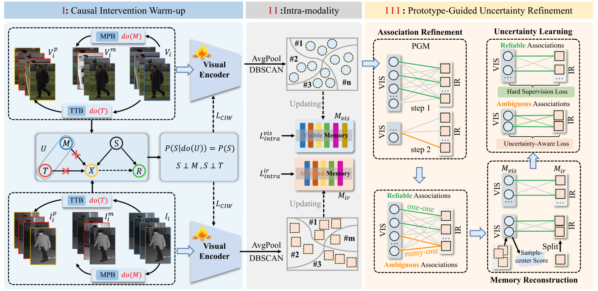

# Causal Bootstrapped Alignment for Unsupervised Video-Based Visible-Infrared Person Re-Identification

PyTorch implementation of **Causal Bootstrapped Alignment (CBA)** for
unsupervised video-based visible-infrared person re-identification, published in
*IEEE Transactions on Information Forensics and Security (TIFS), 2026*.



## Getting Started

### Environment

Tested with Python **3.10.19** and PyTorch **2.9.1+cu130** on an NVIDIA
**RTX 5090**. Dependency versions are listed in
[environment-reproduction.yml](environment-reproduction.yml).

### Datasets

We support the **VCM** and **BUPTCampus (BUPT)** benchmarks:

- [VCM — Download and Preparation](https://github.com/VCM-project233/MITML)
- [BUPTCampus — Download and Preparation](https://github.com/dyhBUPT/BUPTCampus)

Prepare each dataset using the linked instructions, then replace
`/path/to/HITSZ-VCM` or `/path/to/BUPTCampus` below with its root directory.

### Training

Training example on **VCM**:

```bash
 python main.py --mode train --dataset vcm \
  --vcm-root /path/to/HITSZ-VCM \
  --output-dir logs/vcm
```

### Trained Models

Trained model checkpoints are available on [Google Drive](https://drive.google.com/drive/folders/1164hWcyU1IQZ8ErUBV9i5u5TdLVMhcdw?usp=sharing).

### Evaluation

Evaluation example on **VCM**:

```bash
python main.py --mode test --dataset vcm \
  --vcm-root /path/to/HITSZ-VCM \
  --checkpoint-dir logs/vcm/models --output-dir logs/vcm_test
```


## Citation

This implementation builds on our previous work [VLD](https://github.com/Visuang/VLD). If you find our work useful, please consider citing the following papers:

```bibtex
@article{li2026causal,
  author={Li, Shuang and Leng, Jiaxu and Kuang, Changjiang and Tan, Mingpi and Yuan, Yu and Gao, Xinbo},
  title={Causal Bootstrapped Alignment for Unsupervised Video-Based Visible–Infrared Person Re-Identification},
  journal={IEEE Transactions on Information Forensics and Security},
  year={2026},
  volume={21},
  pages={6216--6230}
}

@article{li2025video,
  title={Video-level language-driven video-based visible-infrared person re-identification},
  author={Li, Shuang and Leng, Jiaxu and Kuang, Changjiang and Tan, Mingpi and Gao, Xinbo},
  journal={IEEE Transactions on Information Forensics and Security},
  volume={20},
  pages={5505--5520},
  year={2025},
  publisher={IEEE}
}
```
